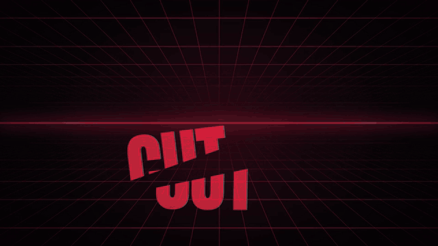

# RAW KINETIQ

A Claude Code skill that turns a song into a kinetic typography lyric video. Hand Claude an
audio file, answer four quick questions, and get back an MP4 where every word hits when it's
sung and the visuals move with the track.



## What it does

- **Times every word.** Whisper large-v3 transcribes the song twice (the full mix and a Demucs
  vocal stem), then lines up your lyrics against it. Chopped vocal chants and ad-libs that
  Whisper can't hear get placed on vocal onsets instead.
- **Reads the song's structure.** Beat grid, kick drums, energy and a 24-band spectrum,
  so drops, builds and breaks look different from verses.
- **Lyrics in bursts.** Long lines play 2 or 3 words at a time, on one line. Each burst slams in,
  lights up word by word as it's sung, and gets sliced in half before the next one lands.
  Chants become giant sliced hits, the hook word becomes a tunnel you fall into, and
  shouts take over the screen one word at a time.
- **Backgrounds that follow the song.** Each section gets its own scene (drifting colour,
  warp streaks, a synthwave grid, kick shockwaves, the hook words scrolling past), and a
  repeated section gets a fresh variant. Kept sparse on purpose: the words are the show.
- **Any format.** 16:9, vertical 9:16 for TikTok/Reels/Shorts, or square. 60 fps by default.
- **Six looks:** `phonk`, `neon`, `toxic`, `gold`, `ice`, `paper`, picked from the genre or by you.

Before it starts, Claude asks four quick questions (format, look, optional corner overlays
like artist name or timer, end title card). Say "just do it" and it uses the defaults.

## Requirements

- [Claude Code](https://claude.com/claude-code)
- Python 3.10+
- Node.js 18+
- ffmpeg (with ffprobe) on your PATH
- Bash: built in on macOS and Linux; on Windows, Git Bash (comes with Git for Windows)
- About 5 GB of free disk for the Python environment and models, set up on first use in
  `~/.raw-kinetiq/venv` (override with the `RAW_KINETIQ_VENV` environment variable)

Everything runs locally. Nothing is uploaded anywhere.

## Install

**As a plugin** (inside Claude Code):

```
/plugin marketplace add bani4kaskashka/Claude-Skill-Raw-Kinetiq
/plugin install raw-kinetiq@raw-kinetiq
```

**Or by hand:** copy the `skills/raw-kinetiq` folder (just that folder) to
`~/.claude/skills/raw-kinetiq`.

## Use

Just ask, in your own words:

> make a kinetic lyric video for ~/Music/my-song.mp3

> RAW KINETIQ this track, vertical for TikTok. Lyrics: ...

Lyrics can be pasted into the chat, read from the file's tags (Suno embeds them), or
transcribed when you have none. Claude checks them against what's actually sung, shows you
any changes, reviews the timing, renders preview stills, and then renders the video next to
your song.

On a typical desktop CPU, a 3-minute song takes about 10 minutes to analyse (only the
first time; it's cached) and about 10 minutes to render at 1080p60.

## Tweaking

After the first render, ask Claude for changes ("the chant at 0:08 is early", "less going
on in the background", "try the neon look"). Under the hood, each song gets a project folder
with:

- `work/lyrics.txt` and `work/sections.json`: the lyrics and the timing of each section
  and line
- `video/src/data/config.json`: theme, colours, size, fps, overlays, end card,
  background style (`auto`, `calm`, `classic`) and burst size (`chunk`)

Re-rendering never re-runs the slow analysis.

## How it works

1. `prepare.py`: beat and energy analysis (librosa), Demucs vocal separation, two Whisper passes
2. `build_timeline.py`: aligns your lyrics to the transcripts, proposes sections, picks a style
   per line, and flags lines it had to guess
3. Claude reviews the guesses against the vocal onsets and energy, like an editor would
4. A [Remotion](https://www.remotion.dev) project renders the video in headless Chrome

## License

RAW KINETIQ is MIT licensed (see [LICENSE](LICENSE)).

It builds on other projects with their own licenses:

- **[Remotion](https://www.remotion.dev)** renders the video. Remotion is free for individuals
  and small teams, but larger companies need a paid company license. Check
  [remotion.dev/license](https://www.remotion.dev/license) before using it at work.
- [faster-whisper](https://github.com/SYSTRAN/faster-whisper) (MIT),
  [Demucs](https://github.com/facebookresearch/demucs) (MIT),
  [librosa](https://github.com/librosa/librosa) (ISC), PyTorch (BSD)
- Fonts come from Google Fonts (SIL Open Font License)

Demo: "Cut" by ca11mebucky.
